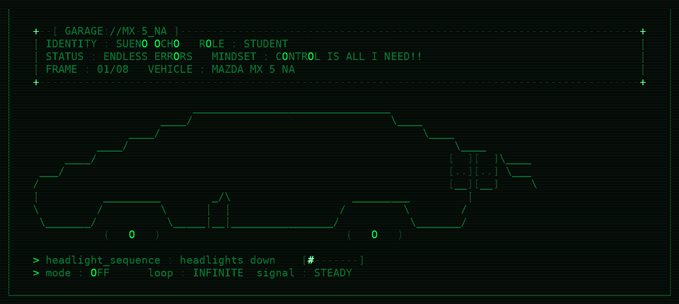

<div align="center">

<pre>
+----------------------------------------------------+
| #### #..# #### #..# .##.   .##. .### #..# .##.     |
| #... #..# #... ##.## #..#   #..# #... #..# #..#    |
| #### #..# ###. #.## #..#   #..# #... #### #..#     |
| ...# #..# #... #..# #..#   #..# #... #..# #..#     |
| #### .##. #### #..# .##.   .##. .### #..# .##.     |
+----------------------------------------------------+
</pre>

**USERNAME : SuenoOcho**  
**ROLE : STUDENT**  
**STATUS : ENDLESS ERRORS**  
**MINDSET : CONTROL IS ALL I NEED!!**

`THEME : #050B07 / #00FF41 / MUTED GREEN / MONOSPACE / CRT-SCANLINE`

```text
[ OK ]    Loading developer identity...
[ OK ]    Initializing creative engine...
[ WARN ]  Endless errors detected.
[ INFO ]  Developer still operational.
[ SUCCESS ] SYSTEM READY.
```

## CONTROL THE CODE. CONQUER THE CHAOS.

</div>

---

## 01 // ABOUT ME

```text
$ whoami
sueno_ocho : student developer
mode       : curious
process    : build -> error -> debug -> repeat
errors     : endless
control    : compulsory
```

```text
$ cat personality.txt
I am a curious student developer who likes experimenting with technology.
I learn by taking things apart, running them, breaking them, and reading
the logs until the "why" finally shows up and I use ARCH btw!

My natural habitat is a terminal window with too many tabs open.
My favorite debugging tool is stubbornness.
My backup debugging tool is printing variables and pretending it was planned.

Currently interested in:
  - programming fundamentals and creative technology
  - small tools, scripts, and interactive experiments
  - terminal interfaces and ASCII visuals
  - A round thing every boy kicks once in their life
  - anything with four wheels, a manual transmission, and pop-up headlights
```

```text
$ system_status
CREATIVE_ENGINE : ONLINE
CURIOSITY       : OVERCLOCKED
ERROR_HANDLING  : IMPOSIBLE
COFFEE_BUFFER   : [ FOR UNKNOWN REASONS, NOT GUARANTEED ]
MIATA_PROTOCOL  : LEGENDARY
NOTE            : When I run a code no-one even god can't tell, why?
```

---

## 02 // TECH STACK

ERROR 400

### PROGRAMMING LANGUAGES

<p align="center">
  
</p>

```text
PYTHON  : CONFIRMED -- tools/generate_miata.py uses Python 
Z#  : CONFIRMED
```

### FRAMEWORKS

```text
ERROR 400
```

### DEVELOPER TOOLS

```text
PILLOW  : CONFIRMED -- renders the animated ASCII Miata GIF
GIT     : GITHUB
EDITOR  : VIM
SHELL   : BASH
```

### OPERATING SYSTEMS

```text
ARCH : I USE ARCH BTW! 
```

---

## 03 // GITHUB ANALYTICS

<div align="center">


</div>

---

## 04 // PROJECT DATABASE

```text
$ ls -la ./projects
TOTAL ENTRIES : 1
SOURCE        : CURRENT WORKSPACE INSPECTION
```

| ID | PROJECT | DESCRIPTION | STACK | REPOSITORY |
| --- | --- | --- | --- | --- |
| 001 | ASCII MIATA GENERATOR | Reproducible Pillow renderer for the animated pop-up-headlight GIF in this profile. | Python, Pillow | `[ LOCAL FILE: tools/generate_miata.py ]` |
| 002 | NO PRE-EXISTING REPOSITORIES DETECTED | Workspace was inspected before writing files; no unrelated projects were invented. | -- | -- |

```text
NOTE : Repository links remain placeholder-free until a real GitHub username and
       real repository URLs are provided. Nothing here is fabricated.
```

---

## 05 // SPECIAL FEATURE // POP-UP PROTOCOL

<div align="center">

</div>

```text
$ ./garage/miata_na --animate
[ OK ]    Mounting Mazda MX-5 NA chassis...
[ OK ]    Loading original ASCII silhouette...
[ OK ]    Wiring pop-up headlight actuators...
[ WARN ]  Night mode is dangerously cool.
[ SUCCESS ] LOOP ESTABLISHED.
```

### ANIMATION SEQUENCE

| FRAME | STATE | SIGNAL |
| --- | --- | --- |
| 1 | HEADLIGHTS DOWN | Closed pop-up slots; classic NA silhouette. |
| 2 | POWERING UP | Both headlight modules begin rising. |
| 3 | HEADLIGHTS UP | Fully extended bright green headlights. |
| 4 | NIGHT MODE | Headlights illuminate and blink with small ASCII beams. |
| 5 | RETURN TO NORMAL | Headlights retract and the loop resets seamlessly. |

### TERMINAL GARAGE

```text
VEHICLE    : MAZDA MX-5 NA
GENERATION : 1989–1997
FEATURE    : POP-UP HEADLIGHTS
STATUS     : LEGENDARY
DRIVE_MODE : TOP DOWN, ERRORS UP, CONFIDENCE FORWARD
```

<details>
<summary>Fallback ASCII illustration</summary>

```text
                         _______________________________
                    ____/                               \____
               ____/                                         \____
          ____/                                                   \____
     ____/                                                       [##][##]\____
 ___/                                                            [##][##] \___
/                                                                [##][##]     \
|          _________        _/\                   _________         |
\         /         \      |  |                 /         \        /
 \_______/           \_____|__|________________/           \_______/
           (   O   )                             (   O   )
```

</details>

---

## 06 // SOCIAL LINKS

```text
$ cat links.cfg
GITHUB    : SuenoOcho
LINKEDIN  : ERROR 401
INSTAGRAM : @rabbit.7633634
EMAIL     : ichbinkaka03016@gmail.com
PORTFOLIO : ERROR 400
```


---

## 07 // SHUTDOWN SEQUENCE

```text
THANKS FOR VISITING MY PROFILE.

KEEP BUILDING. KEEP DEBUGGING. KEEP EXPLORING.

SHALL THEIR BE ERROR IN EVERY CODE YOU RUN.

SEE YOU ON THE NEXT COMMIT.

[ END OF TRANSMISSION ]
```
